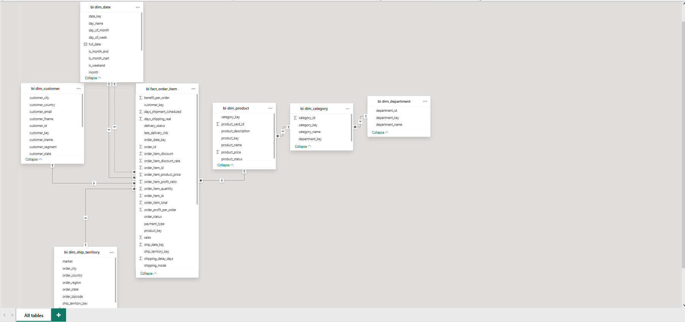
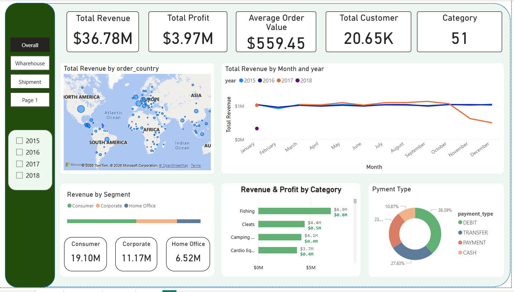
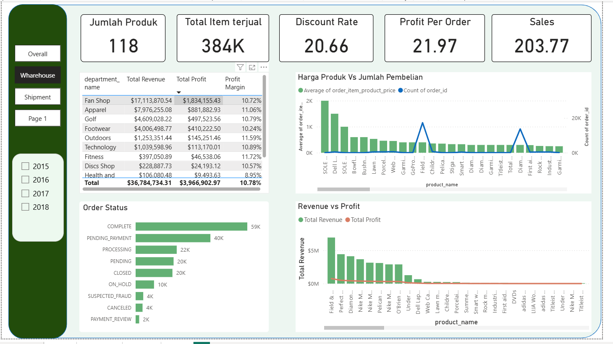
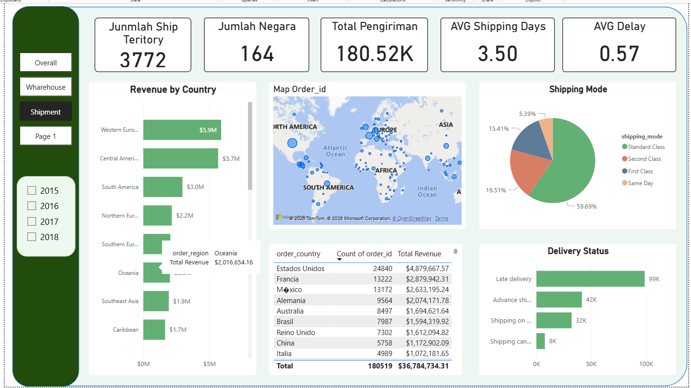

# DataCo Supply Chain Data Warehouse (MySQL + Power BI)

A dimensional data warehouse built in MySQL 8 from the DataCo Smart Supply Chain dataset, loaded through an idempotent SQL ETL (UPSERT), and visualized in three Power BI dashboards (Overall, Product Performance, Shipment).

> Course project for Business Intelligence, Telkom University Surabaya. Each member of the group built a complete solution independently; mine was selected as the group's final deliverable. I designed the dimensional model, wrote the ETL, and built the dashboards end to end.

## At a glance

| | |
|---|---|
| Source | DataCo Smart Supply Chain (Kaggle), 180,519 order lines, Jan 2015 - Jan 2018 |
| Warehouse | MySQL 8.0, database `bi` |
| Model | 1 fact table + 6 dimensions (star schema with a normalized product hierarchy) |
| ETL | Pure SQL, `INSERT ... ON DUPLICATE KEY UPDATE`, safe to re-run |
| BI | Power BI, 3 dashboard pages |

## Architecture

```
DataCo CSV ──load──▶ stg_supply_chain ──ETL (UPSERT)──▶ dim_* + fact_order_item ──▶ Power BI
                       (raw, 53 cols)                     (star / snowflake hybrid)
```

## Data model



- **Fact:** `fact_order_item`, grain = one order line item. `order_id` is a degenerate dimension.
- **Star dimensions:** `dim_customer`, `dim_ship_territory`, `dim_date`.
- **Snowflaked product hierarchy:** `dim_product` -> `dim_category` -> `dim_department` (normalized to avoid repeating category and department names on every product).
- **Role-playing dimension:** `dim_date` is joined twice to the fact (`order_date_key` active, `ship_date_key` inactive in Power BI, used through `USERELATIONSHIP`).
- **Derived column:** `shipping_delay_days` is a generated column (`days_shipping_real - days_shipment_scheduled`).

| Table | Rows |
|---|---|
| `fact_order_item` | 180,519 |
| `dim_customer` | ~20.65K |
| `dim_ship_territory` | 3,772 |
| `dim_product` | 118 |
| `dim_category` | 51 |
| `dim_department` | 11 |
| `dim_date` | 1,133 |

## Design decisions

- **Idempotent ETL.** Every load is an UPSERT keyed on the source natural key (a `UNIQUE` index per dimension, `order_item_id` on the fact). Re-running the script does not duplicate rows; table checksums are identical before and after a second run.
- **Load order.** Parents before children (department -> category -> product), all dimensions before the fact.
- **Deterministic dimensions.** When one natural key has several attribute variants in staging, the variant from the most recent order wins (`ROW_NUMBER()`), so results do not depend on row order.
- **Fail loudly.** FK columns are `NOT NULL` and joins are `LEFT JOIN`, so a missing dimension key makes the insert fail instead of silently loading a bad row.
- **Continuous calendar.** `dim_date` is generated as a gap-free calendar covering both order and ship dates.
- **Integrity at the schema level.** Foreign keys, `CHECK` constraints, and column comments on every table.

## Data quality checks

`sql/05_validation.sql` verifies after each load:

- fact row count equals staging row count (180,519);
- no NULL foreign keys;
- revenue difference between staging and fact is 0.00;
- every staging-to-dimension join is 1:1 (no fan-out);
- all dates parse and the calendar covers every fact date;
- table checksums are unchanged after re-running the ETL.

`sql/06_dashboard_reconciliation.sql` reproduces the dashboard KPIs directly from the warehouse, so every number reported here can be checked with a query.

## Dashboards

<!-- TODO: add the 3 screenshots to dashboard/ and keep the filenames below -->




## Selected findings

- Order status: 39,832 order lines (14,382 distinct orders, 22.1% of lines) are in `PENDING_PAYMENT`, worth about $8.1M in sales.
- <!-- TODO: late delivery rate, e.g. "XX.X% of order lines are late deliveries", taken from sql/06 query 5 -->
- <!-- TODO: shipping mode with the highest late rate, from sql/06 query 5 -->
- <!-- TODO: top department by revenue and margin, from sql/06 query 3 -->

Data covers Jan 2015 to Jan 2018, and January 2018 is the only 2018 month, so year-over-year comparisons for 2018 are not meaningful.

## How to run

Requires MySQL 8.0+ and the dataset CSV from Kaggle (not included in this repository).

1. Run `sql/00_create_database.sql`
2. Run `sql/01_staging.sql`, then load the CSV into `stg_supply_chain` (template inside the file; the CSV is latin-1 encoded)
3. Run `sql/02_dimensions.sql`, then `sql/03_fact.sql`
4. Run `sql/04_etl_upsert.sql`
5. Run `sql/05_validation.sql` and `sql/06_dashboard_reconciliation.sql`

To rebuild from scratch, run `sql/99_reset.sql` (drops the fact and dimensions, keeps staging) and repeat steps 3-5.

## Repository layout

```
sql/         DDL, ETL, validation, dashboard reconciliation
dashboard/   Power BI file (.pbix, if size allows) and screenshots
docs/        Data model diagram, DAX measure definitions
```

## Dataset

DataCo Smart Supply Chain for Big Data Analysis (Kaggle). Check the dataset's license on its Kaggle page before reuse. The data is not redistributed here.
